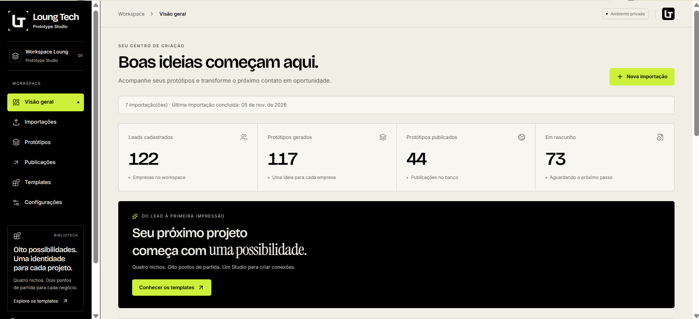
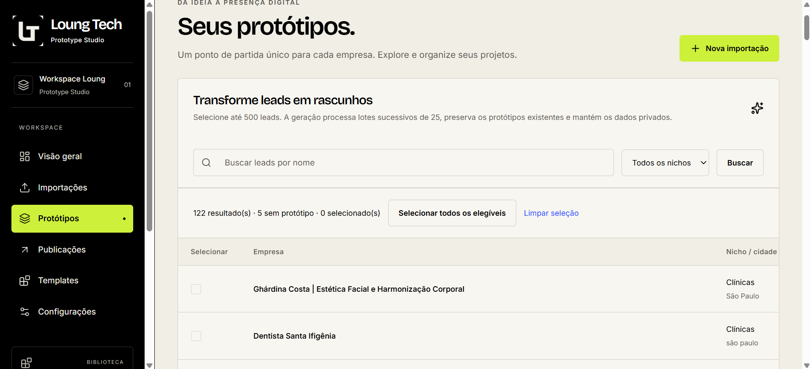
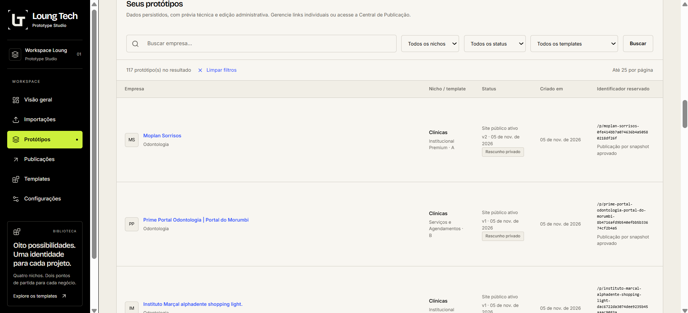
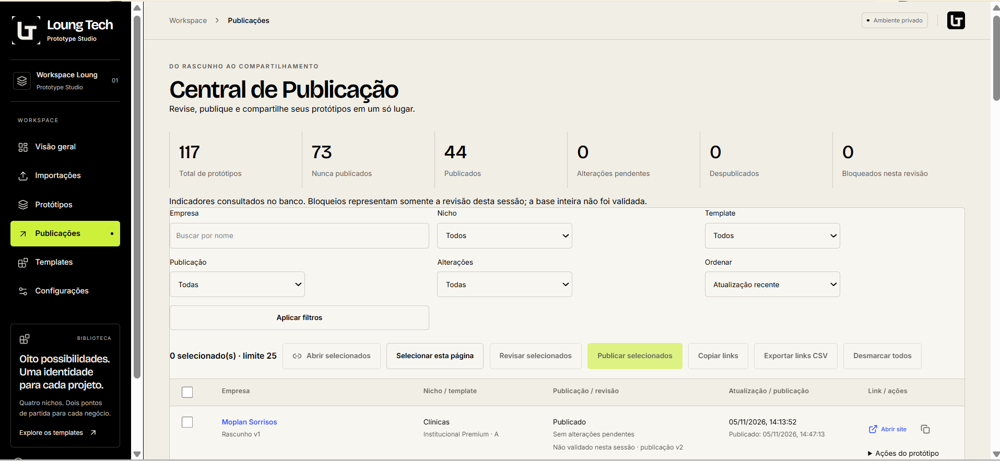

# 🚀 Loung Prototype Studio

### Plataforma de geração, personalização e publicação de protótipos web


O **Loung Prototype Studio** é uma plataforma desenvolvida para automatizar a criação de protótipos profissionais de sites a partir de informações de potenciais clientes.

Criado no contexto da **Loung Tech**, o sistema transforma dados importados de planilhas em apresentações visuais personalizadas, permitindo editar, visualizar e publicar protótipos por meio de links individuais.

A proposta é unir **desenvolvimento web, automação comercial e personalização de interfaces** em uma única ferramenta.

🌐 **Aplicação:** https://loung-prototype-studio.vercel.app/

> **Status:** projeto em desenvolvimento contínuo. A área administrativa exige autenticação e autorização. A disponibilidade das funcionalidades em produção depende da configuração do ambiente e das migrations do banco de dados.

---

## 🎯 O problema

Na prospecção de serviços digitais, apresentar uma solução visual personalizada pode exigir várias etapas manuais:

- Analisar as informações de uma empresa.
- Selecionar um modelo visual adequado ao segmento.
- Personalizar nome, textos, imagens e identidade.
- Preparar uma demonstração navegável.
- Publicar o material.
- Organizar os links para apresentação comercial.

Repetir esse processo individualmente torna a operação mais trabalhosa.

O Loung Prototype Studio foi criado para organizar essas etapas e facilitar a produção de demonstrações web personalizadas.

## 💡 A solução

A plataforma permite importar informações comerciais, associar empresas a templates específicos e gerar protótipos com estrutura visual reutilizável.

O processo combina geração estruturada, personalização e publicação.

```text
        IMPORTAÇÃO DE LEADS
               |
               v
       CLASSIFICAÇÃO POR NICHO
               |
               v
       SELEÇÃO DE TEMPLATE
               |
               v
       GERAÇÃO DO PROTÓTIPO
               |
               v
      PERSONALIZAÇÃO / PREVIEW
               |
               v
       REVISÃO E PUBLICAÇÃO
               |
               v
       LINK PÚBLICO INDIVIDUAL
```

O resultado é um fluxo centralizado para criação e gerenciamento de protótipos comerciais.

---

## ✨ Principais funcionalidades

### 📥 1. Importação de leads

- Importação de planilhas CSV e XLSX.
- Mapeamento de informações.
- Validação de dados.
- Identificação de registros duplicados.
- Histórico de importações.
- Persistência no banco de dados.

Os dados importados podem ser utilizados na geração dos protótipos.

### 🏢 2. Templates por segmento

O sistema possui templates direcionados a quatro segmentos comerciais, com duas variantes por nicho:

| Segmento | Template A | Template B |
|---|---|---|
| Clínicas | Apresentação institucional | Abordagem alternativa |
| Advocacia | Estilo clássico | Estilo moderno |
| Imobiliárias | Apresentação premium | Apresentação pessoal |
| Restaurantes | Identidade gastronômica premium | Cardápio digital |

Cada template possui características visuais e estruturais adaptadas ao segmento.

**Total: oito templates A/B**, com documentação específica no repositório.

### ⚙️ 3. Geração de protótipos

- Associação de leads aos templates.
- Geração individual e em lote.
- Reutilização de estruturas predefinidas.
- Personalização de informações.
- Controle do estado dos protótipos.
- Persistência das configurações.

A geração estruturada ajuda a manter consistência entre protótipos, sem exigir a construção manual de cada página.

### 🎨 4. Personalização visual

O editor permite trabalhar com elementos como:

- Cores.
- Identidade visual.
- Logotipo.
- Títulos e descrições.
- Imagens.
- Conteúdos e serviços.
- Organização de seções.

O objetivo é transformar um template reutilizável em uma demonstração alinhada ao contexto de cada empresa.

### 👁️ 5. Visualização e revisão

- Prévia dos templates.
- Visualização das personalizações.
- Revisão antes da publicação.
- Navegação em diferentes tamanhos de tela.
- Separação entre ambiente administrativo e páginas públicas.

### 🌐 6. Publicação de protótipos

O sistema utiliza publicação por snapshots, preservando uma versão aprovada do protótipo.

Funcionalidades:

- Publicação manual.
- Links públicos individuais.
- Rotas no formato `/p/[slug]`.
- Republicação.
- Despublicação.
- Gerenciamento do estado de publicação.

Esse modelo separa o conteúdo em edição da versão apresentada ao público.

### 📋 7. Central de publicações

- Consulta dos protótipos publicados.
- Busca e filtros.
- Paginação.
- Seleção de registros.
- Organização dos links públicos.
- Ações de gerenciamento de publicações.
- Exportação de informações.

### 🔐 8. Autenticação e autorização

- Login com Supabase Auth.
- Área administrativa protegida.
- Controle de acesso por associação de usuários autorizados.
- Validações de autorização no servidor.
- Proteção de dados por Row Level Security (RLS).

O projeto foi concebido inicialmente como ferramenta interna, sem cadastro público de usuários.

---

## 📸 Demonstração visual

As capturas abaixo devem ser adicionadas a partir da interface real da aplicação.

### Dashboard administrativo



### Gerenciamento de leads



### Geração de protótipos



### Editor visual


### Central de publicações



> As imagens acima são placeholders de documentação. Adicione os arquivos correspondentes em `docs/screenshots/` antes de publicar o README.

---

## 🛠️ Stack tecnológica

| Camada | Tecnologia | Responsabilidade |
|---|---|---|
| Frontend | Next.js 16 | Aplicação web e roteamento |
| Interface | React 19 | Componentes e interatividade |
| Linguagem | TypeScript | Tipagem e manutenção |
| Estilização | Tailwind CSS 4 | Sistema visual |
| Backend | Next.js Server Actions e Route Handlers | Operações no servidor |
| Banco de dados | PostgreSQL / Supabase | Persistência |
| Autenticação | Supabase Auth | Identidade e sessões |
| Segurança | PostgreSQL RLS | Controle de acesso aos dados |
| Validação | Zod | Validação de estruturas |
| Planilhas | Papa Parse e read-excel-file | Leitura de CSV e XLSX |
| Deploy | Vercel | Hospedagem da aplicação |

---

## 🏗️ Arquitetura

O projeto utiliza uma arquitetura baseada no Next.js App Router, com separação entre interface administrativa, lógica de negócio, persistência e páginas públicas.

```text
                  ADMINISTRADOR
                        |
                        v
                NEXT.JS / REACT
                        |
              +---------+---------+
              |                   |
              v                   v
       ÁREA ADMINISTRATIVA    PÁGINAS PÚBLICAS
              |                   |
              v                   v
       AUTENTICAÇÃO         SNAPSHOTS PUBLICADOS
              |
              v
       CAMADA DE SERVIDOR
              |
       +------+------+
       |             |
       v             v
   SUPABASE AUTH   POSTGRESQL
                     |
                     v
              LEADS / TEMPLATES
              PROTÓTIPOS
              PUBLICAÇÕES
```

### Decisões arquiteturais

**Separação entre edição e publicação**

A utilização de snapshots permite manter uma versão pública aprovada independentemente de alterações posteriores no protótipo em edição.

**Persistência estruturada**

Os dados de leads, templates, protótipos e publicações são organizados em tabelas relacionais, com personalizações estruturadas em JSONB.

**Controle de acesso**

A autorização administrativa é verificada no servidor e reforçada por políticas de acesso no banco de dados.

**Templates reutilizáveis**

O uso de estruturas específicas por nicho permite ampliar a variedade de demonstrações sem duplicar toda a implementação.

---

## 📂 Estrutura do repositório

```text
loung-prototype-studio/
├── public/                 # Imagens e recursos estáticos
├── src/
│   ├── app/                # Páginas e rotas
│   │   ├── (admin)/        # Área administrativa
│   │   ├── api/            # Endpoints
│   │   ├── login/          # Autenticação
│   │   ├── p/              # Protótipos publicados
│   │   └── preview/        # Visualização
│   └── ...                 # Componentes e serviços
├── supabase/
│   └── migrations/         # Evolução do banco
├── docs/                   # Documentação funcional
├── scripts/                # Scripts auxiliares
├── tests/                  # Testes automatizados
├── package.json
└── README.md
```

---

## 🚀 Executando localmente

### Pré-requisitos

- Node.js 24 LTS recomendado.
- npm.
- Projeto Supabase configurado.
- Migrations aplicadas.
- Usuário autorizado no ambiente administrativo.

### 1. Clone o repositório

```bash
git clone https://github.com/nandoalvesferreira20-png/loung-prototype-studio.git

cd loung-prototype-studio
```

### 2. Instale as dependências

```bash
npm ci
```

### 3. Configure o ambiente

Crie o arquivo `.env.local` com as configurações públicas do seu projeto Supabase:

```dotenv
NEXT_PUBLIC_SUPABASE_URL=
NEXT_PUBLIC_SUPABASE_PUBLISHABLE_KEY=
```

Utilize a URL e a chave publicável do mesmo projeto.

**Atenção:** a aplicação não deve receber chaves administrativas secretas nessas variáveis. Não publique credenciais ou arquivos de ambiente contendo segredos.

A configuração inicial do banco e a autorização dos usuários estão documentadas no repositório.

### 4. Execute a aplicação

```bash
npm run dev
```

Acesse:

http://localhost:3000

No Windows com PowerShell, se o comando `npm` estiver bloqueado pela política de execução, utilize:

```powershell
npm.cmd run dev
```

A aplicação exige uma conta administrativa autorizada para acessar as páginas privadas.

---

## 🧪 Testes e qualidade

O projeto utiliza ferramentas para validação estática, testes automatizados e padronização de código.

```bash
# Testes unitários
npm test

# Verificação de tipos
npm run typecheck

# Análise estática
npm run lint

# Verificação de formatação
npm run format:check

# Build de produção
npm run build
```

Também existem comandos específicos para testes HTTP e integração:

```bash
npm run test:http
npm run test:integration
```

Os